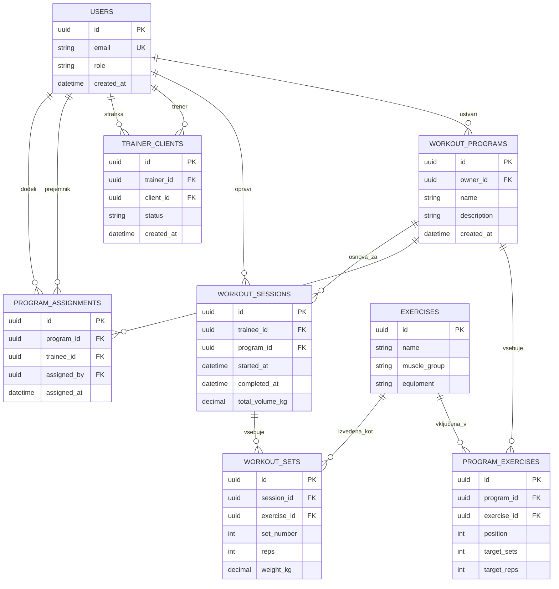

# GymProgress – podatkovni model

## Uporabniški profil in avtentikacija

`USERS` predstavlja aplikacijski profil uporabnika. Njegov `id` se navezuje
na `auth.users.id` v Supabase Auth, ki upravlja prijavne podatke in seje.
Gesel oziroma njihovih zgoščenih vrednosti ne shranjujemo v aplikacijski
tabeli. Polje `email` v profilu je kontaktni podatek; vir prijavne identitete
ostaja Supabase Auth. Utemeljitev: [ADR 0002](adr/0002-avtentikacija-supabase-auth.md).

## Osnutek podatkovnega modela (Mermaid ER)

