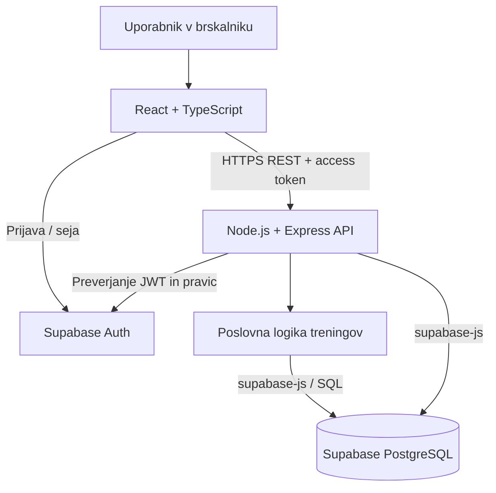

# GymProgress – arhitektura in tehnološki sklad

## Arhitektura
Aplikacija uporablja **React frontend**, **Node.js/Express REST API** in gostovano storitev **Supabase** (PostgreSQL + Supabase Auth). Lokalno se izvajata samo frontend in backend; podatkovna baza ni lokalna.

### Glavni deli
1. **Frontend:** prikaz programov, beleženje serij, pregled rezultatov in prijava prek Supabase Auth.
2. **Backend API:** preverjanje prijavljenega uporabnika, uporabniških vlog, povezav trener–stranka in lastništva podatkov.
3. **Poslovna logika:** zaključevanje treningov, izračun volumna in zaznavanje osebnih rekordov.
4. **Supabase:** gostovana PostgreSQL baza za podatke aplikacije in Supabase Auth za uporabniške račune.

### Diagram

## Tehnološki sklad

| Področje | Tehnologija | Namen |
|---|---|---|
| Frontend | React, TypeScript, Vite | Spletni uporabniški vmesnik. |
| Oblikovanje | Tailwind CSS | Prilagodljiv prikaz. |
| Backend | Node.js, Express, TypeScript | REST API in poslovna pravila. |
| Podatkovna baza | Supabase PostgreSQL | Gostovana relacijska baza. |
| Avtentikacija | Supabase Auth | Registracija, prijava in upravljanje sej. |
| Lokalni razvoj | Node.js, npm | Zagon frontenda in backenda brez lokalne baze. |
| Testiranje | Postman | Testiranje logike in API-ja. |
| Grafi (kasneje) | Recharts | Grafični prikaz napredka. |

## Arhitekturne odločitve

- **[Supabase namesto lokalne baze (ADR 0001)](adr/0001-gostovana-baza-supabase.md):** gostovana PostgreSQL baza in avtentikacija zmanjšata potrebo po lokalni infrastrukturi.
- **[Supabase Auth (ADR 0002)](adr/0002-avtentikacija-supabase-auth.md):** ni treba implementirati lastnega shranjevanja gesel ali izdajanja žetonov.
- **[Ločen Express backend (ADR 0003)](adr/0003-locen-express-backend.md):** poslovna pravila in preverjanje dostopov ostanejo na strežniku.
- **[REST API (ADR 0004)](adr/0004-komunikacija-prek-rest-api.md):** enostavno testiranje s Postmanom in možnost kasnejše mobilne aplikacije.
- **[Relacijski model (ADR 0005)](adr/0005-relacijski-podatkovni-model.md):** zagotavlja povezave med uporabniki, programi, vajami in treningi.
- **[Izračuni ob zaključku treninga (ADR 0006)](adr/0006-izracuni-ob-zakljucku-treninga.md):** volumen in osebni rekordi temeljijo na dejansko opravljenih serijah.
- **[React in TypeScript (ADR 0007)](adr/0007-react-typescript-frontend.md):** komponente podpirajo interaktivno urejanje programov in beleženje serij.
- **[Dostop po vlogah in povezavah (ADR 0008)](adr/0008-dostop-po-vlogah-in-povezavah.md):** backend preverja vlogo, lastništvo in potrjeno povezavo trener–stranka.

Celotne utemeljitve, alternative, posledice ter navodila za dodajanje in
nadomeščanje odločitev so v [kazalu ADR](adr/README.md).
