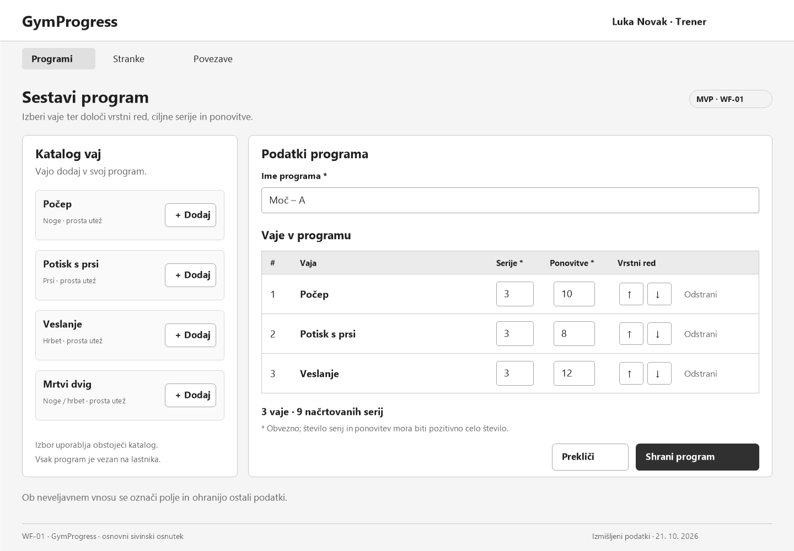
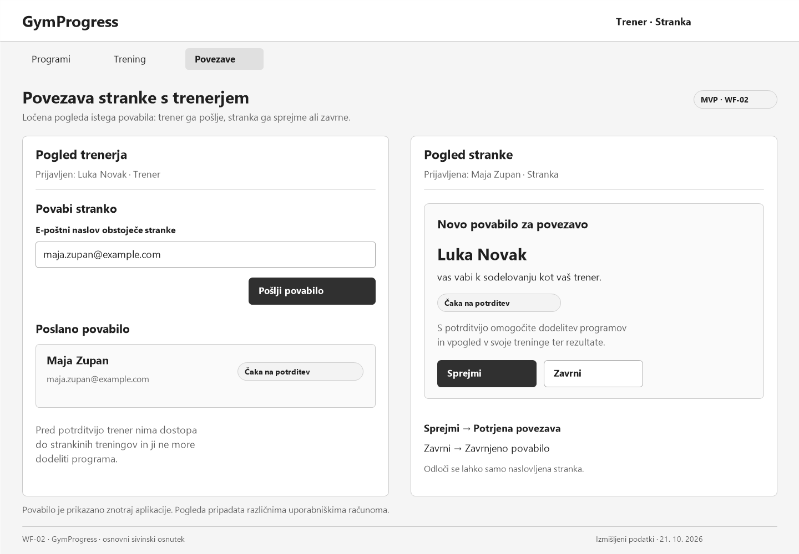
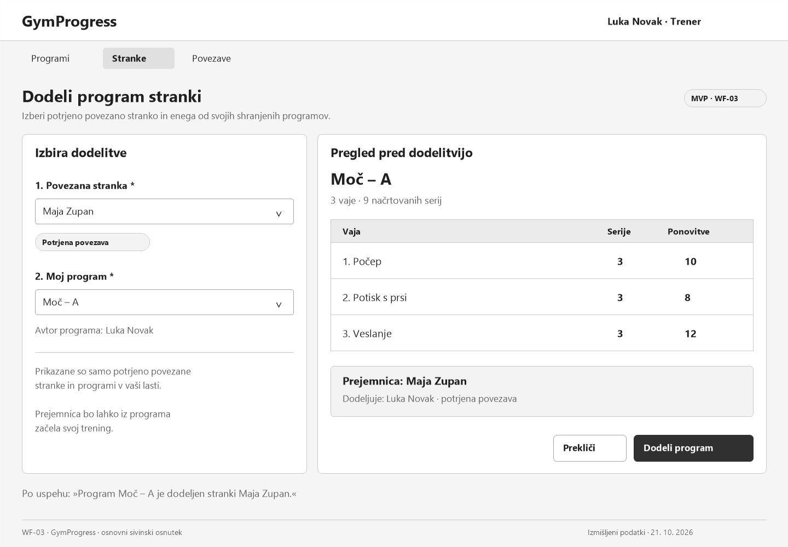

# GymProgress – wireframe-i

## WF-01 – Sestavljanje programa

**Vloga:** trener; enak obrazec lahko za svoj program uporablja stranka.  
**Pokritost:** F-01, US-02.

## WF-02 – Povabilo in potrditev povezave

**Vlogi:** trener in stranka, prikazana v dveh ločenih pogledih.  
**Pokritost:** F-02, US-03.

## WF-03 – Dodelitev programa

**Vloga:** trener.  
**Pokritost:** F-03, US-04.

